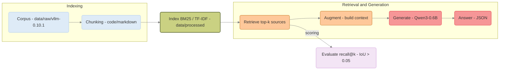
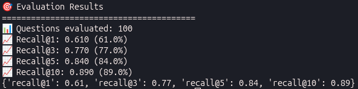
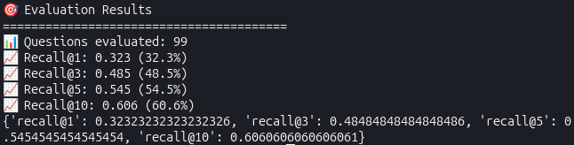

<div align="center">
    <i>This project has been created as part of the 42 curriculum by npillet</i>
    <h1>RAG against the machine</h1>
    <h3>Will you answer my questions?</h3>
</div>

## Table of contents
- [Description](#description)
- [Instructions](#instructions)
    - [Example Usage](#example-usage)
- [System Architecture](#system-architecture)
- [Chunking Strategy](#chunking-strategy)
- [Retrieval Method](#retrieval-method)
- [Performance Analysis](#performance-analysis)
- [Design Decisions](#design-decisions)
    - [BM25 vs TF-IDF](#bm25-vs-tf-idf)
    - [Data Models](#data-models)
- [Challenges Faced](#challenges-faced)
- [Resources](#resources)

## Description
A model has only the information that was given during its training. In order to add new knowledge, instead of retraining it with the new data, we can can use **Retrieval-Augmented Generation** also known as **RAG**.</br>
With this, you give access to external sources of the wanted knowledge and let the model pull an answer from this.

RAG has four stages:
- **Indexing**: organise the data so it can be searched
- **Retrieving**: match a question against the index and pull the most relevant snippets
- **Augmenting**: filter those snippets and place them in a model's context window
- **Generating**:read the context and produce the answer

For this project, the goal is to recreate a working **RAG**.

## Instructions
With this list of commands, once entered inside the terminal and after installing the dependencies, the full pipeline will be able to run.
``` bash
# Create the index
make index

# Retrieve the sources for a query
make search

# Retrieve the sources for a dataset
make search_dataset

# Answer a query with the previously retrieved sources
make answer

# Answer a dataset with the previously retrieved sources
make answer_dataset

# Measure the retrieval quality with a recall@k metric
make evaluate
```

And below, you will find other commands:
| Command | Description |
| :---: | --- |
| `make install` | Install the project's dependencies |
| `make run` | Execute the program (like the `make` command) |
| `make debug` | Run the script using the Python built-in debugger |
| `make clean` | Remove temporary files and caches |
| `make lint` | Execute the `flake8` and `mypy` commands |
| `make lint-strict` | Execute the `flake8` and a stricter version of `mypy` commands |

### Example Usage
By entering these commands in order, the full pipeline will be able to run.
``` bash
# Create the index
uv run python -m src index --max_chunk_size 2000

# Retrieve the sources for a dataset
uv run python -m src search_dataset --dataset_path data/datasets/UnansweredQuestions/dataset_docs_public.json --k 10 --save_directory data/output/search_results/UnansweredQuestions

# Measure the retrieval quality with a recall@k metric
./moulinette evaluate_student_search_results data/output/search_results/UnansweredQuestions/dataset_docs_public.json data/datasets/AnsweredQuestions/dataset_docs_public.json --k 10 --max_context_length 2000

# Answer a dataset with the previously retrieved sources
uv run python -m src answer_dataset --student_search_results_path data/output/search_results/UnansweredQuestions/dataset_docs_public.json --save_directory data/output/search_results_and_answer/UnansweredQuestions
```

## System Architecture
Below is a visual representation of a classic RAG pipeline:


In my implementation, the process is divided into classes:
- **Chunker**: This class will chunk a given corpus of texts as long as they are either `.py`, `.md` or `.txt` files. It splits the source files to create chunks and preserves the context.
- **RetrieverEngine**: This class will retrieve sources using the chunked corpus. It will group together the top-k chunks to answer queries.
- **AnswerGeneration**: This class will generate an answer to a query or a series of queries using an AI model. It uses the previously retrieved sources in the prompt used to answer a query.
- **Recall**: Evaluate the text retrieval and its relevance by comparing it to a series of questions that already have a top-k sources.

And everything is controlled by **RAGEngine**, which goes through the necessary classes to answer a given command.

## Chunking Strategy
During the chunking, the file format needs to be considered. A code won't be separated in the same way as a text. In this project, we will face three formats:
- **Python code(.py)**: It uses `RecursiveCharacterTextSplitter.from_language()` function. In its parameters, the language is specified, here `Python`. Therefore, it takes into account the language syntax and maintains the context.

- **Documentation(.md and .txt)**: It also uses `RecursiveCharacterTextSplitter.from_language()` function for `Markdown` and simply `RecursiveCharacterTextSplitter()` for simple text. It's aware of the separations of text, like titles.

On top of this, an overlap of 15% of the chunk size was chosen to keep enough context from the previous chunk and the next one.

## Retrieval Method
The retrieval is based on BM25 and uses the `bm25s` dependency:
- **Stemming**: By using `PyStemmer` dependency, similar words are grouped together.
- **Ranking**: The ranking is determined with a function from the dependency and the program chooses the top-k sources within it

## Performance Analysis
There are a few expected performances, such as:
- **Indexing time**: at most 5 minutes for the whole corpus
- **Retrieval throughput**: at most 90 seconds for 200 questions
- **Recall@5**: at least 80% on docs questions and 50% on code questions

For the indexing time and the retrieval throughput, the program manages to do each in just a few seconds.

For the recall@5, below are the results:</br>
- This is the document recall@k:
<div align="center">
  
</div>
The recall@5 is equal to 84.0%, which is above 80.0% and therefore passes.

</br>

- This is the codes recall@k:
<div align="center">
  
</div>
The recall@5 is equal to 54.5%, which is above 50.0% and therefore also passes.

## Design Decisions
When choosing between BM25 and TF-IDF for the retrieval, a comparison of the two was required to choose the one that would most adapt to the needs of the project.

### BM25 vs TF-IDF
The main differences between BM25 and TF-IDF are in their approach to scoring documents.</br>
BM25 considers various factors such as document length, while TF-IDF mainly rewards term frequency without accounting for document length variations.

#### Scoring Mechanism
For BM25, the term frequency handling introduces a slightly different formula for the TF part compared to TF-IDF. It allows a more refined evaluation of term importance within documents.</br>
Document length normalization is taken into account in BM25; therefore, it can provide more accurate relevance scores.

#### Advantages and Limitations
<table>
  <tr>
    <td>&nbsp;</td>
    <th>&emsp;BM25</th>
    <th>&emsp;TF-IDF</th>
  </tr>
  <tr>
    <th>Pros</th>
    <td>Comprehensive approach to ranking</td>
    <td>Excels in simplicity and ease of implementation</td>
  </tr>
  <tr>
    <th>Cons</th>
    <td>May face limitations in scenarios where semantic understanding is crucial</td>
    <td>Lacks the depth of analysis that BM25 offers</td>
  </tr>
</table>

#### Conclusion
BM25 is an improvement of TF-IDF by addressing its problems.</br>
At the end, BM25 was chosen over TF-IDF

### Data Models
In the project, every model was unmodified except *MinimalSource*, which has a content section that stocks the chunk. It eases the answer generation process by having easy access during the prompt engineering.

## Challenges Faced
During the project, one of the challenges faced concerned the chunking process. When using the moulinette to verify that everything was in order, the recall@k calculations were all equal to 0.</br>
After a bit of digging, I managed to find out it was because of the content given to the chunks. Every time, it was the entire file content that was given making it give wrong chunks during the retrieval.</br>
By giving the correct part of the file, the problem was resolved.

## Resources
### Notions
- [Introduction to RAG](https://blog.stephane-robert.info/docs/developper/programmation/python/rag-introduction/)

- [Qwen3-0.6B](https://huggingface.co/Qwen/Qwen3-0.6B)

- [BM25 vs TF-IDF](https://www.myscale.com/blog/bm25-vs-tf-idf-deep-dive-comparison/)

#### Dependencies
- [Python Fire](https://github.com/google/python-fire)

- [LangChain](https://www.ibm.com/fr-fr/think/topics/langchain)

- [LangChain Text Splitter](https://docs.langchain.com/oss/python/integrations/splitters)

- [BM25](https://github.com/xhluca/bm25s)

### GitHub
- [Overtekk](https://github.com/Overtekk/RAG-against-the-machine)
